# VISION COMPANY

**첫 개발 직장 전, 함께 일하는 하루를 연습합니다.**

### 시작하기 어렵고.
### 제대로 가는지도 모르겠고.

취업을 준비하는 청년 **15명을 직접 만났습니다.** 인터뷰에서 발견한 두 가지 페인포인트가 있습니다.

> **해야 할 공부는 알고 있지만, 혼자서는 시작과 마감을 지키기 어렵다.**  
> **지금 하는 준비가 실제 취업에 도움이 되는지 모르겠다.**

## 혼자서는 지키기 어려운 하루에 회사의 구조와 강제성을, 취업을 향한 준비에, 함께 일하는 연습을.

**VISION COMPANY는 서울에서 개발 직무 취업을 준비하는 청년을 위한 AI 가상회사입니다.** 인터뷰에서 발견한 두 가지 문제에, 두 가지 방식으로 대응합니다.

### 01. 시작과 마감을 지키기 어렵다면 — AI 가상회사(재택근무)

정해진 시간에 출근하고, 오늘 할 일을 보고하고, 마감에 결과를 제출합니다. 미완료라면 재보고·추가근무·이월 점검으로 이어집니다.
**목표는 스스로 정하되, 약속한 보고와 마감은 끝까지 확인합니다.** 혼자 미루던 준비를 회사의 일과 안에서 실행하도록 돕습니다.

**왜 가상회사일까요?** 월급을 받는 직장이 아닌데도, 회사처럼 하루를 보내는 프로그램을 찾는 청년들이 있습니다. 니트컴퍼니는 월급 없는 가상회사 프로그램이며, 2023년 KBS 보도에서 대표는 시즌당 약 **100명 모집**, 해당 기수 **12시간 만에 137명 신청**으로 급히 마감한 사례를 설명했습니다. 이는 특정 기수의 참여 수요 사례입니다. [공식 소개](https://neetpeople.kr/neetcompany), [KBS 「9층시사국 — 2023, 청년의 삶」](https://v.daum.net/v/3Zn9QlNFTN).

우리는 이 사례에서 **함께 하루를 시작하고 자신의 일을 공유하는 구조에 대한 수요**를 읽었습니다. 이를 서울의 개발 취업 준비 청년이 집에서도 사용할 수 있는 **온라인 재택형 AI 가상회사**로 설계합니다. 니트컴퍼니도 온라인 출퇴근을 운영했으며, 우리의 추가 설계는 AI 팀장의 업무 지시·재보고 관리와 AI 타 부서 동료에게 설명하는 일과입니다.


> *출근부터 업무 지시 메일, 결과 제출과 퇴근보고까지의 구체적인 흐름은 아래 「04 — SOLUTION · 데모」에서 확인할 수 있습니다.* 

### 02. 취업에 도움이 되는 준비인지 막막하다면 — AI 타 부서와 업무 공유

AI가 코드 작성을 돕는 시대, 개발자에게는 구현 능력에 더해 자신의 작업을 다른 직군이 이해하도록 설명하고, 요구사항과 제약을 조율하는 소통 능력이 중요합니다.
VISION COMPANY는 첫 개발 직장을 준비하는 청년이 AI 디자이너·기획자·마케터와 업무를 공유하며, 이러한 소프트스킬을 연습하도록 돕습니다.
프롬프트로 역할과 업무 목적을 설정한 **AI 디자이너·기획자·마케터**에게 오늘 배운 것과 만든 것을 설명합니다. 동료들은 각자의 업무 관점에서 질문합니다.

- **디자이너:** “사용자가 기다리는 동안에는 어떤 화면을 보나요?”
- **기획자:** “이번에 가능한 범위와 아직 안 되는 부분을 알려주세요.”
- **마케터:** “사용자에게 이 기능의 장점을 한 문장으로 어떻게 소개하면 될까요?”

상대가 이해하도록 설명하고, 예상하지 못한 질문에 답하고, 제약과 대안을 전달하는 **직무 간 소통의 소프트스킬을 연습**합니다. 사용자의 개발 분야에 맞춰 대화를 구성하며 특정 개발 직무로 제한하지 않습니다.

### 설명하기 위한 공부는, 시작부터 다릅니다.

아침부터 **누구에게 무엇을 위해 설명할지** 정합니다. 저녁에 동료가 이해해야 하니, 공부하고 작업하는 동안 핵심·목적·사용 방법·제약을 생각하게 하는 설계입니다.

> *설명을 예상하며 공부할 때의 학습 차이와 서비스 적용 방식은 아래 「03 — LEARNING DESIGN · 설계 근거」에서 논문과 실제 발췌 자료로 확인할 수 있습니다.* 

**학습은 설명할 준비로, 결과물은 업무 공유의 근거로 이어집니다.** 설명을 예상하는 학습의 연구 근거는 아래 03절에서 확인할 수 있습니다. 이를 우리 앱의 작업 품질·협업 역량·취업 성과 향상으로 연결하는 효과는 실증으로 확인합니다.

| 인터뷰에서 발견한 문제 | 해결 방식 | 남기는 근거 |
|---|---|---|
| 혼자서는 시작과 마감을 지키기 어렵다 | AI 가상회사의 출근·필수 보고·마감·재보고 관리 | 계획·제출·미완료 대응·이월 해소 이력 |
| 지금 하는 준비가 취업에 도움이 되는지 모르겠다 | AI 타 부서에 설명하며 학습을 정리하고 소프트스킬 연습 | 설명·질문 응답·제약과 대안·피드백 반영 이력 |

축적한 기록은 **성실성과 소프트스킬을 구체적인 활동으로 설명하는 자료**가 됩니다. PDF·엑셀 내보내기를 통해 지원 시 보조 자료로 활용하는 방향을 제안합니다. AI가 개인의 성실성이나 채용 역량을 인증하는 의미는 아닙니다.

### 어제의 약속을 기억하고, 오늘 다시 묻는 동료.

**하루가 바뀌어도 준비가 처음부터 시작되지 않습니다.** AI 팀장은 미완료 과제와 재보고 약속을 다시 확인하고, 타 부서 동료는 이전 대화를 기억하고 있습니다.

회사라는 배경에 **끝까지 확인하는 관리**와 **업무 맥락을 기억하는 동료**를 결합합니다. 수행·설명·수정 기록은 날짜를 넘어 연결됩니다. 이 기억 기능은 새로 구체화한 개발 제안이며 구현 완료를 뜻하지 않습니다.

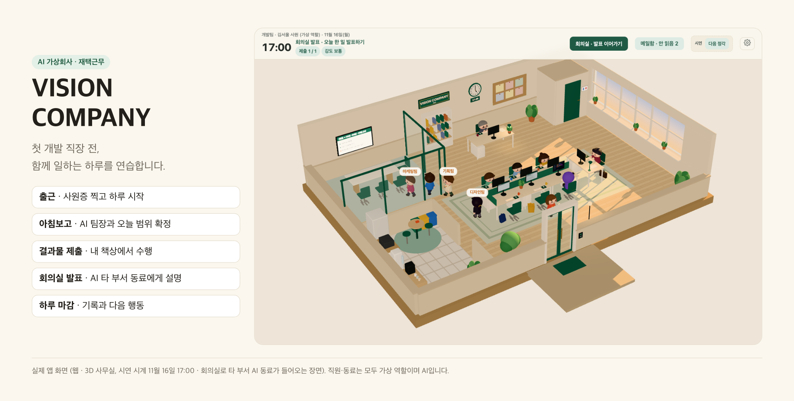

> **삽입 가이드:** 실제 가상회사 화면을 넣습니다. AI 타 부서 공유·스트릭·내보내기 화면이 시안이라면 ‘기획 시안’이라고 표시합니다.

**서비스 실행:** [접속 주소 입력]  
**시연 영상:** [영상 주소 입력]

> **현재 상태 안내:** 출근·아침보고·결과물·주간 피드백은 기존 기획서의 핵심 범위입니다. 현재 빌드의 실행 확인은 별도로 필요합니다. **AI 타 부서 설명 대화, 동료의 업무 맥락 기억, 활동 스트릭, 직무 연결, PDF·엑셀 내보내기는 이번에 구체화한 제안 기능**이며 구현 완료로 표시하지 않습니다.

---

### 02 — BIG IDEA · 문제 발견
## 혼자 준비하는 시간에도,
## 함께 일하는 구조가 필요합니다.

공부할 것은 있습니다. 하지만 언제 시작하고, 어디까지 끝내고, 무엇으로 확인할지는 혼자 정해야 합니다.

모든 것은 혼자하기에 계획을 세워도 첫 착수가 밀리고, 마감이 밀리면 다음 날의 시작도 어려워집니다. 무언가를 했더라도 누군가의 질문을 대답해주기는 어렵습니다. 보통 누군가를 설득할 생각으로 깊게 공부하지 않고 이는 금방 잊어버립니다.

첫 번째 어려움에는 **하루 시작부터 끝까지 관리하는 AI 가상회사**, 두 번째 어려움에는 **학습을 설명으로 연결하고 다른 직군과 소통하는 연습**으로 이 두 문제를 풀었습니다. 취업 준비의 방향에 대한 막막함을 줄이기 위해, 실제로 무엇을 수행하고 어떤 소통을 연습했는지 기록을 남겨 PDF로 뽑아줍니다. 이 자료는 얼마나 성실히 살았는지 보여주는 자료로 사용할 수 있습니다.

### 월급 없는 회사에도, 출근하려는 청년들이 있었습니다.

집에서 혼자 준비할 때 시작과 마감을 지키기 어렵다는 인터뷰의 첫 번째 문제를 풀기 위해, 우리는 **니트컴퍼니의 가상회사 형식**을 참고했습니다.

| 확인한 사례 | 수치와 의미 |
|---|---|
| 시즌당 모집 규모 | 대표 인터뷰 기준 약 100명 |
| 보도에서 언급한 해당 기수 | 12시간 만에 137명 신청 후 급히 마감 |
| 회사처럼 하는 활동 | SNS 출근 보고·스스로 정한 업무 인증·정기 화상회의 |

출처: [2023년 KBS 「9층시사국 — 2023, 청년의 삶」, 니트컴퍼니 대표 인터뷰와 활동 소개](https://v.daum.net/v/3Zn9QlNFTN). 월급 없는 가상회사라는 설명은 [니트생활자 공식 소개](https://neetpeople.kr/neetcompany)에 근거합니다.

**돈을 받는 직장이 아니어도, 자신의 일을 정하고 함께 일과를 보내는 경험을 찾는 사람이 있었습니다.** 우리는 이 수요 사례와 직접 인터뷰를 바탕으로, 집에서도 출근·업무 지시·마감·재보고를 이어가는 재택형 AI 가상회사를 구상했습니다.

137명을 모집 정원 약 100명과 비교할 수 있지만, 실제 선발·탈락 인원이나 경쟁률로 바꾸어 표시하지 않습니다. 이 사례는 모든 구직 청년의 수요나 우리의 엄격 관리 규칙에 대한 선호를 증명하지 않으며, AI 서비스로의 적용 효과는 별도 검증합니다. 니트컴퍼니의 실제 사람 간 관계를 AI가 동일하게 대체한다고 주장하지 않습니다.

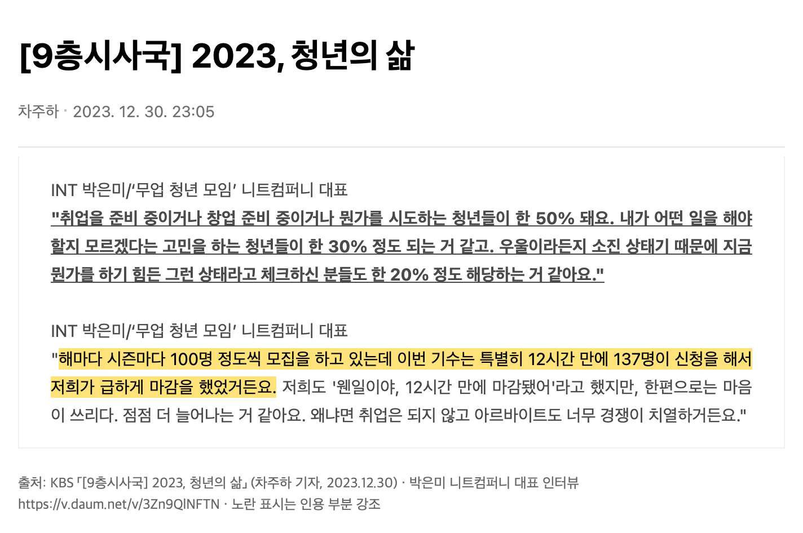

> **삽입 가이드:** KBS 기사의 대표 인터뷰 중 약 100명·12시간·137명이 나오는 부분을 출처와 함께 캡처합니다. 공식 소개와 온라인 출퇴근 사례를 별도 배치하고, 기사 조회수를 신청 인원으로 사용하지 않습니다. 위 경로는 아직 실제 파일이 없는 자리표시자입니다.

### ESSENTIAL QUESTION
**서울의 개발 취업 준비 청년이 혼자서도 목표를 끝까지 수행하고, 다른 직군이 이해하도록 자신의 작업을 설명하며, 그 과정을 보여줄 수 있을까?**

### 사용자 인터뷰 15명 · 리서치 근거

청년 15명의 일상 루틴, 무기력 경험, 취업 준비의 어려움과 필요한 도움을 공통 질문 13개로 정리했습니다.

📊 [15명 사용자 인터뷰 공통 질문 정리 (Excel)](./docs/research/인터뷰_15명_공통질문_정리.xlsx)

*개인별 응답을 요약한 정성 리서치이며, 전체 청년을 대표하는 통계는 아닙니다.*

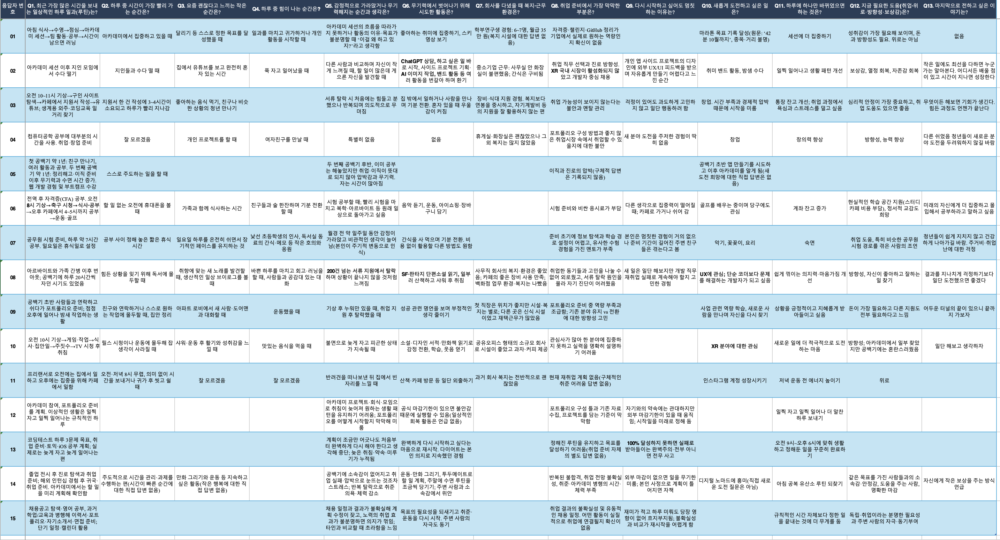

> **삽입 가이드:** 최신 인터뷰 15명 기록에서 두 문제에 대응하는 익명 응답을 배치합니다. 조사일·대상·질문·참여자 ID를 표기합니다. 응답 빈도를 집계하지 않았다면 비율이나 ‘전원’ 표현은 사용하지 않습니다.

---

### 03 — LEARNING DESIGN · 설계 근거
## 설명할 사람이 있으면, 공부의 시작이 달라집니다.

“오늘 강의 세 개를 봐야지”와 “오늘 배운 것을 저녁에 동료에게 설명해야지.”

우리는 두 번째 목표가 하루의 준비 방식을 바꿀 수 있다는 데 주목합니다. 상대가 이해하려면 무엇이 핵심인지, 왜 필요한지, 어떤 예로 보여줄지 생각하며 준비하게 만들자는 것입니다.

### 연구 근거 1 — 실제로 가르치기 전에도 나타난 차이

Nestojko 등(2014)은 참가자가 같은 글을 시험 또는 다른 학생에게 가르칠 준비를 하며 공부하게 했습니다. 실제 가르치기는 실시하지 않았습니다. 두 실험에서 가르칠 것을 예상한 조건은 회상 내용의 충실성·조직화, 핵심 내용 관련 문항에서 이점을 보였습니다.

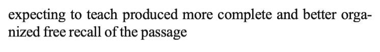

*원문 일부 실제 캡처. 가독성을 위해 선택한 줄을 이어 배치했으며 문구는 바꾸지 않았습니다. 출처: Nestojko et al., 2014, Memory & Cognition, p.1038 초록. [논문·DOI](https://doi.org/10.3758/s13421-014-0416-z).* 

**우리의 설계 해석: 저녁에 갑자기 설명시키기보다, 아침부터 설명할 상대와 목적을 알려줍니다.**

### 연구 근거 2 — 가상의 상대를 위해 배우는 경험

Chase 등(2009)의 연구에서는 컴퓨터 에이전트를 가르친다고 생각한 학생들이 자신을 위해 학습하는 조건보다 학습 활동에 더 많은 시간을 쓰고 더 많이 배웠습니다.

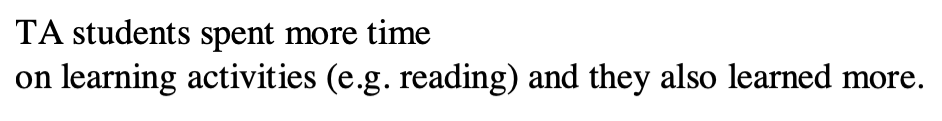

*원문 일부 실제 캡처. 선택한 줄을 이어 배치했습니다. 출처: Chase et al., 2009, 저자 공개 원고 p.2 초록. [Stanford 연구 원문](https://aaalab.stanford.edu/assets/papers/2009/Protege_Effect_Teachable_Agents.pdf).* 

**우리의 설계 해석: AI 타 부서 동료에게 ‘내 결과를 전달받아 할 일’을 부여해 설명할 이유를 만듭니다.**

두 연구는 교육·학습 환경의 근거입니다. AI 타 부서 공유, 성인 구직자의 하루 만족도, 실제 작업 품질·취업 효과를 직접 검증한 결과는 아닙니다. 이러한 확장은 우리 서비스의 실증 과제입니다.

### CHALLENGE STATEMENT
**AI 시대, 서울에서 개발 직무 취업을 준비하는 청년이 꾸준히 실행하고 다른 직군과 소통하는 역량을 기르며, 그 과정을 기록으로 뽑아 실제 취직에 사용할 수 있도록 돕자.**

출근·보고·마감의 구조로 실행을 관리하고, AI 디자이너·기획자·마케터와의 업무 공유를 통해 상대가 이해할 수 있게 설명하는 연습을 제공합니다. 축적된 수행·설명·재보고·수정 이력은 자신의 **성실성과 소프트스킬을 설명하는 증빙 자료**로 활용하도록 지원합니다.

여기서 증빙은 실제 활동의 근거를 뜻하며 AI가 발급하는 성실성·역량 인증이 아닙니다.

인터뷰에서 발견한 실행·방향의 어려움에 대응하는 설계 가설입니다. 기존 인터뷰 요약은 기획서 pp.2–3에 있으며 최신 15명 기록은 별도 갱신이 필요합니다.

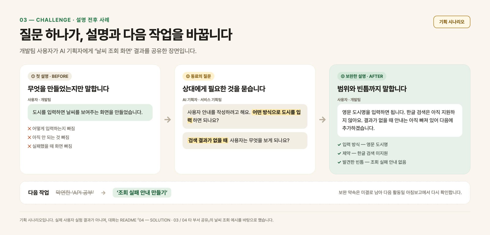

> **삽입 가이드:** 첫 목표 → 공유 준비 → 첫 설명 → 질문 → 보완한 설명·결과를 보여줍니다. 위 연구 캡처 2개는 실제 파일이며, 이 사용자 사례 이미지는 추가가 필요합니다.

---

### 04 — SOLUTION · 데모
## 하루를 알차게 사용하고 기록되어 어딘가에 지원할 때 성실함의 증표로 사용합니다.

대상은 **서울에 거주하며 첫 개발 직장을 준비하는 청년**입니다. 프런트엔드·백엔드·앱 등 특정 개발 분야로 제한하지 않습니다. AI 동료는 사용자가 설정한 개발 직무와 오늘의 활동에 맞춰 질문합니다. 인터뷰 15명이 모두 개발 관련 직무 준비자였습니다.

### 목표는 스스로. 보고와 마감은 반드시.

**귀찮아서 미룰 일을, 끝까지 확인하는 회사입니다.** 출근만 체크하고 사라지는 앱을 만들지 않습니다. 등록한 활동일에는 정시 출근과 아침보고, 마감 결과 제출, 타 부서 공유와 퇴근보고를 필수로 둡니다.

| 상황 | 관리 규칙 — 개발 목표 |
|---|---|
| 09:00 출근 누락 | 지각·미출근 상태와 출근 요청 알림 |
| 아침보고 미확정 | 목표·마감·완료 기준이 확정될 때까지 보완 요청 |
| 수행 중 미응답·자리 비움 | 상태 확인과 복귀 요청, 승인된 휴식과 구분 |
| 18:00 결과물·공유 미완료 | 사유·남은 범위를 확인하고 재보고 요청 |
| 당일 완료·필수 마감 과제 잔여 | 18~19시 저녁 이후 19~22시 추가근무 상태와 후속 점검 |
| 이월 가능 과제 잔여 | 사유·다음 활동일 계획을 제출해야 이월 처리 |
| 22:00까지 미완료 | 다음 활동일로 이월하고 다음 아침보고에서 다시 확인 |

앱을 닫아도 미보고를 완료로 처리하지 않습니다. 다음 접속에 미결 항목을 다시 보여줍니다. 설명 대화는 짧게 진행하되 건너뛰었다고 보고 완료로 인정하지 않습니다. AI 장애 시 수동 보고로 의무를 이행할 수 있습니다.

기존의 카메라 출근·착석 확인은 관리 기능으로 유지하는 설계입니다. 권한 거부·감지 오류는 실제 결석과 구분하고 수동 확인 경로를 둡니다. 알림의 채널·간격·상한과 휴식 예외는 사전 공개하며 시스템 알림 권한을 우회하지 않습니다. 이 규칙들은 구현·효과 확인이 필요한 기획 범위입니다.

아래는 사용자가 ‘영문 도시명으로 날씨를 조회하는 화면 구현’을 구체적으로 보고한 **기획 시나리오**입니다.

#### 01 / 04 — 업무 입력과 사내 메일
### 내가 입력한 계획이, 팀장님의 업무 지시로 도착합니다.

사용자는 오늘 수행할 작업의 내용·범위·마감·완료 기준을 앱에 상세하게 입력합니다.

> **사용자 입력:** “도시명을 입력하면 API에서 날씨를 받아 보여주는 화면을 만들겠습니다. 영문 도시명 입력·조회 버튼·기온과 날씨 표시까지 구현하고, 오후 6시까지 코드와 실행 화면을 제출하겠습니다.”

입력한 계획을 바탕으로 AI 팀장이 사내 메일을 보냅니다.

> **사내 메일 · AI 팀장**  
> **제목: [업무 지시] 도시별 날씨 조회 화면 구현 / 금일 18:00 마감**  
> 오늘은 영문 도시명 입력, 조회 버튼, 기온과 날씨 표시가 포함된 날씨 조회 화면을 구현해주세요. 코드와 실행 화면은 오후 6시까지 제출 바랍니다. 완료 후 기획팀에 사용 방법과 구현 범위를 공유해주세요.

**사용자 계획 입력 → AI 팀장 사내 메일 발송 → 업무 수행 → 결과 제출·타 부서 공유**로 이어집니다. 스스로 정한 계획을 회사의 업무 지시와 마감으로 전환하는 경험입니다.

AI는 사용자가 입력한 범위와 마감을 보존하고, 보고·제출 절차를 메일로 명확히 안내합니다. 필요한 항목이 빠졌다면 앱에서 보완을 요청한 후 메일을 생성하며, 임의로 새로운 구현 과제를 추가하지 않습니다. 마감에는 이 메일과 연결된 업무를 기준으로 수행·미완료·재보고를 점검합니다.

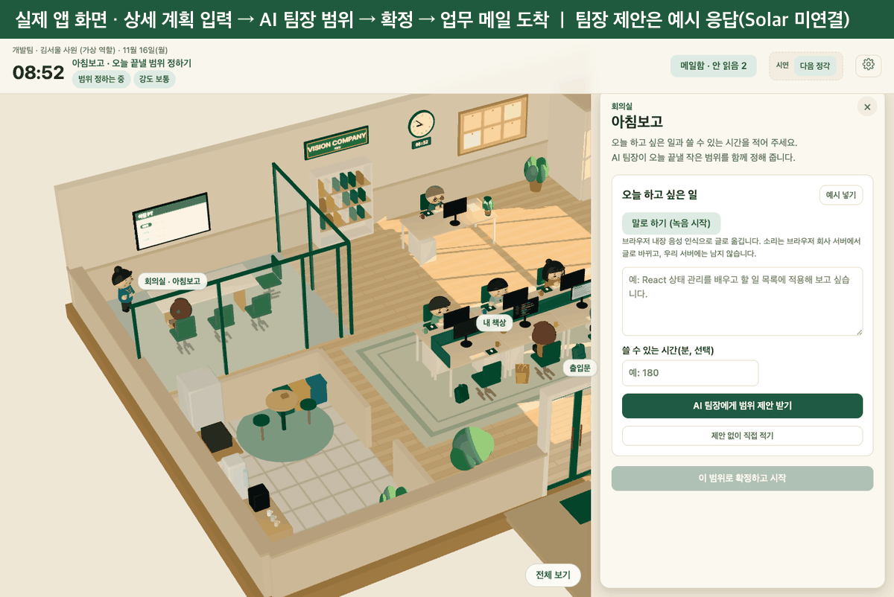

> **삽입 가이드:** 상세 계획 입력 → 사내 메일 도착 → 업무 지시 확인을 연결합니다. 실제 메일과 원래 입력의 범위·마감이 일치하는지 보여주고 미구현 화면은 시안이라고 표시합니다.

#### 02 / 04 — 직접 수행
### 배운 것을, 작은 결과로.

학습한 내용을 직접 적용하고 코드·화면·문서 등의 결과를 제출합니다. 오늘 목표가 수정 작업이라면 변경 전후와 수정 이유를 남길 수 있습니다.

접속 시간이나 강의 재생 시간만으로 학습과 수행을 확인하지 않습니다.

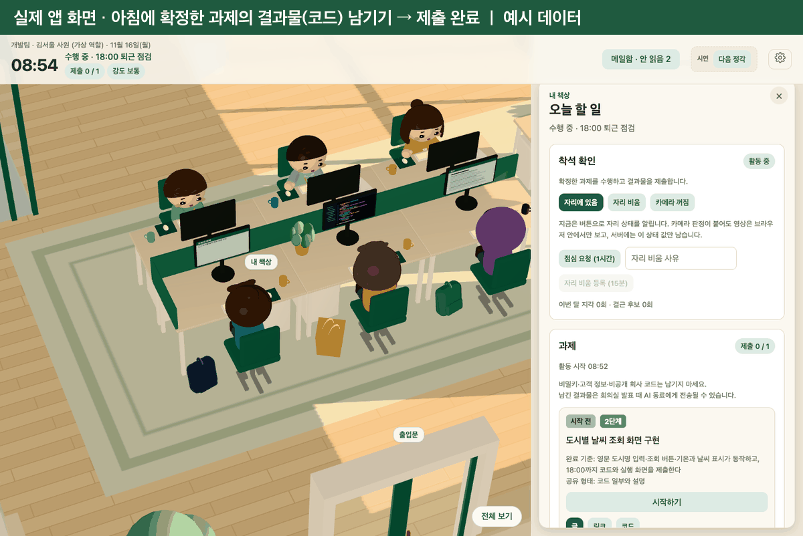

> **삽입 가이드:** 아침에 합의한 목표와 동일한 결과물을 보여줍니다. 실제 지원하는 제출 형식과 AI가 읽을 수 있는 범위를 명시합니다.

#### 03 / 04 — 타 부서 공유
### 설명하다 막힌 곳이,
### 다음에 배울 것이 됩니다.

사용자는 개발팀 직원이 되어 AI 기획자에게 결과를 공유합니다. 기획자는 사용자의 결과를 바탕으로 사용자 안내를 준비해야 합니다. **상대에게 필요한 정보가 있으니, 설명할 이유가 생깁니다.**

> 사용자: “도시를 입력하면 날씨를 보여주는 화면을 만들었습니다.”  
> AI 기획자: “제가 사용자 안내를 작성하려고 해요. 사용자는 어떤 방식으로 도시를 입력하면 되나요?”  
> 사용자: “영문 도시명을 입력하면 됩니다. 한글 검색은 아직 지원하지 않아요.”  
> AI 기획자: “그럼 영문 입력을 안내하겠습니다. 검색 결과가 없을 때 사용자는 무엇을 보게 되나요?”  
> 사용자: “그 안내는 아직 빠져 있네요. 다음에 추가하겠습니다.”

*가상의 기획 대화입니다. 실제 구현·사용 효과를 입증하는 자료는 아닙니다.*

**첫 설명에서는 지나쳤던 ‘실패한 경우’를 동료의 질문으로 발견했습니다. 이제 다음 작업은 막연한 ‘API 공부’가 아니라 ‘조회 실패 안내 만들기’로 구체화됩니다.**

동료가 알아야 할 목적·사용 방법·완료 범위·제약을 설명하면서 오늘 한 일을 정리합니다. 이미 전달한 내용은 다시 묻지 않고, 기본 후속 질문 1~2개로 짧게 마무리합니다. 학습만 한 날에는 적용해볼 상황임을 밝히고 배운 내용을 설명할 수 있습니다.

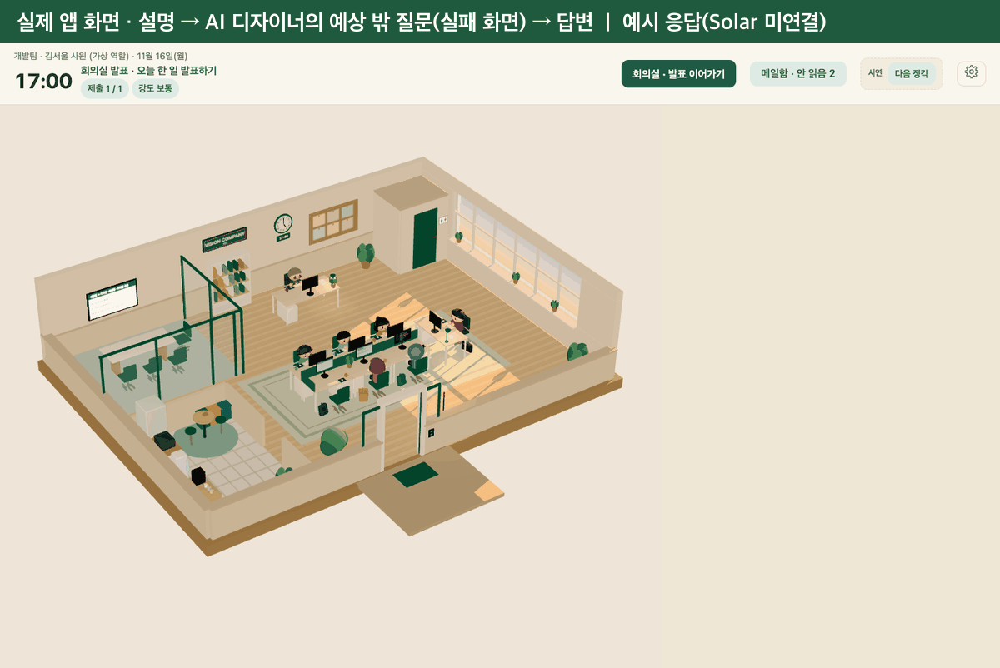

> **삽입 가이드:** 사용자의 설명 → 동료의 후속 업무에 필요한 질문 → 추가 설명 → 정리와 다음 행동을 보여줍니다. 현재 제안 기능이며, 구현 전에는 기획 데모라고 표시합니다.

#### 04 / 04 — 하루 마감
### “오늘 무엇을 했지?”에,
### 보여줄 답이 생깁니다.

의미 있는 하루를 보냈다는 감각을 AI의 칭찬만으로 채우려 하지 않습니다. **내가 설명할 수 있는 내용, 실제 남긴 결과물, 질문을 받고 보완한 흔적**을 함께 확인하는 마무리를 제안합니다. 이것이 하루의 성취감과 다음 활동에 도움이 되는지는 실증으로 확인합니다.

| 기록 항목 | 시나리오 예시 |
|---|---|
| 오늘 목표 | 영문 도시명 입력·조회 버튼·기온과 날씨 표시 구현, 18시 코드·실행 화면 제출 |
| 제출 근거 | 코드·실행 화면 |
| 설명한 내용 | 영문 도시명 입력 방식과 한글 검색 미지원 |
| 발견한 빈틈 | 조회 실패 시 사용자 안내 미구현 |
| 직무 연결 | 외부 데이터 연동·화면 상태 처리 연습 |
| 다음 행동 | 실패 안내를 구현하고 다시 공유 |

*가상의 시연 예시이며 실제 사용자 검증 결과가 아닙니다.*

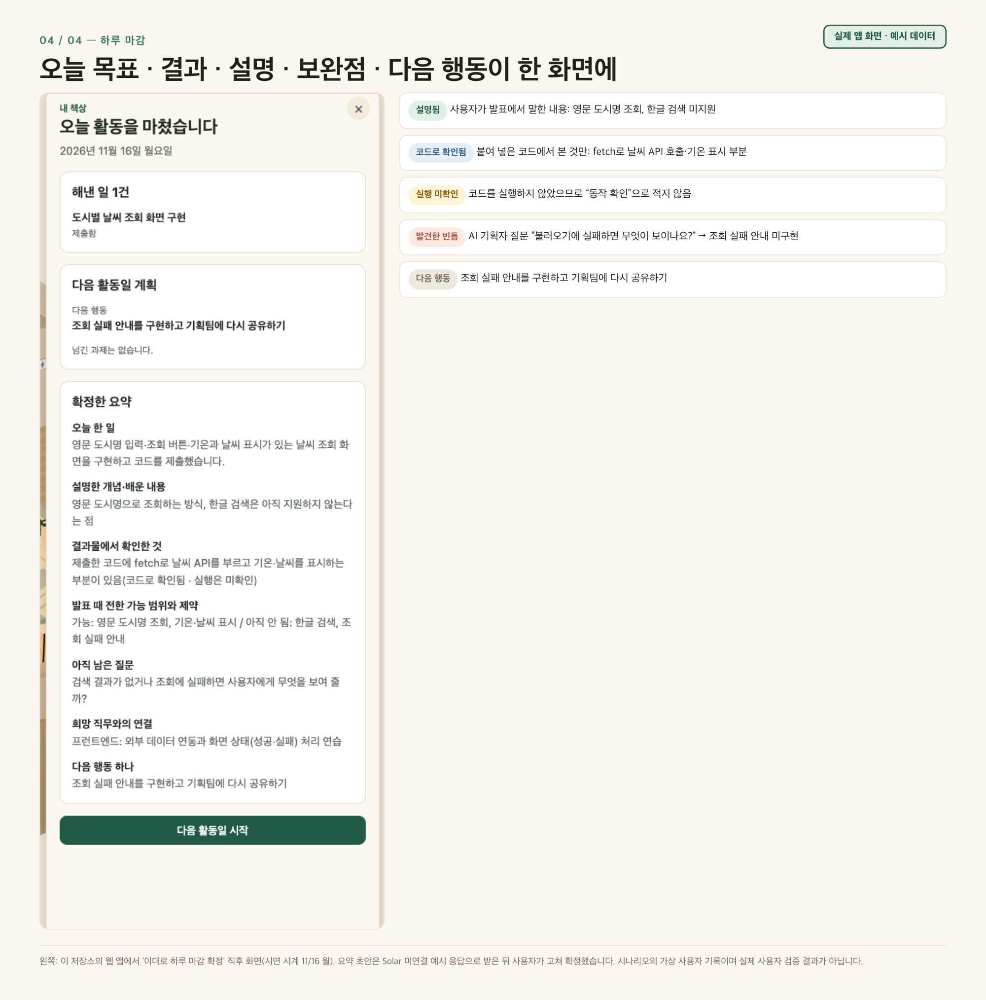

> **삽입 가이드:** 사용자의 실제 발언과 제출물에서 확인된 내용만 넣습니다. ‘설명됨’, ‘코드로 확인됨’, ‘실행 미확인’ 등 근거 수준을 분리합니다.

---

### 05 — AI DESIGN · AI 활용과 기술 흐름
## 설명은 사용자가하고 필요한 질문은 타 부서 AI 페르소나가 합니다.

출근 기록·스트릭 계산·문서 출력은 일반 프로그램 로직이 담당합니다. **AI는 매일 다른 활동과 설명을 듣고, 상대 부서의 업무에 필요한 질문을 돌려주는 역할**을 맡습니다.

정해진 질문 목록을 반복하거나 “수고했어요”로 끝내는 경험에서 나아가, 사용자가 실제로 전달한 내용에 따라 다음 대화가 달라지도록 설계합니다.

| AI가 받는 맥락 | 대화에 반영하는 방식 |
|---|---|
| 오늘 목표와 활동 종류 | 학습·제작·수정 중 무엇을 공유하는지 구분 |
| 사용자 설명과 선택한 자료 | 아직 전달하지 않은 정보에 집중 |
| 동료의 부서와 후속 업무 | 왜 그 정보가 필요한지 드러나는 질문 |
| 앞선 질문·답변 | 이미 설명한 내용은 반영하고 반복 질문 방지 |

### 페르소나에, 일할 이유를 더합니다.

| 동료 | 맡은 일 | 질문 예시 |
|---|---|---|
| AI 팀장 | 오늘 끝낼 범위와 공유 결과 합의 | “오늘 가능한 시간 안에 어떤 결과를 공유할까요?” |
| AI 기획자 | 공유받은 기능의 사용자 안내 준비 | “사용자가 알아야 할 사용 조건은 무엇인가요?” |
| AI 디자이너 | 화면 상태와 흐름 협의 | “조회 중에는 어떤 화면이 보이나요?” |
| AI 마케터 | 사용자 대상 기능 소개 준비 | “사용자가 얻는 이점을 기술 용어 없이 설명해줄 수 있나요?” |

서비스의 타 부서 역할은 디자이너·기획자·마케터로 구성하는 설계입니다. 대화별로 오늘의 작업에 적절한 상대를 배정합니다. 캐릭터 수보다 **사용자 설명에 따라 적절한 반응이 달라지는지**를 먼저 검증합니다. 동료는 모두 AI이며 실제 사람과 협업한 이력으로 표시하지 않습니다.

### 기억하는 것은 대화 전체보다, 함께 일하는 데 필요한 맥락입니다.

| 기억할 정보 | 다음 대화에서 하는 일 |
|---|---|
| 합의한 목표·완료 기준·마감 | 팀장이 진행과 재보고 약속 확인 |
| 각 동료에게 전달한 목적·가능 범위·제약 | 해당 동료가 이미 들은 설명을 반복해서 묻지 않음 |
| 미답변 질문·보완점·재보고 시점 | 다음 활동에서 미결 사항부터 확인 |
| 수정 전후 결과와 설명 | 변경된 내용과 해소된 질문 연결 |

모델 자체를 매번 재학습시키는 방식이 아닙니다. **구조화한 기록을 저장하고 다음 요청에 관련 맥락을 전달하는 설계**입니다. 팀장은 관리에 필요한 기록을, 타 부서 동료는 자신에게 공유된 정보를 중심으로 받습니다. 서로 다른 부서가 모든 내용을 이미 알고 있는 것처럼 행동하지 않습니다.

각 기억에는 원본 대화·과제 ID·일자·미결/해소 상태를 연결합니다. 사용자가 기억을 확인·수정·삭제할 수 있게 하고, AI의 추정을 확인된 사실로 저장하지 않습니다. 종료된 질문은 다음 날 다시 미결로 불러오지 않으며, 같은 과제가 수정되면 이전 버전과 연결합니다. 실제 저장·검색·권한 처리는 구현 확인이 필요한 개발 범위입니다.

### 실제 협업 자료로, 질문의 이유를 만듭니다.

디자이너·기획자·마케터는 다른 관점의 전문가입니다. 말도 안 되는 요구를 무작위로 던지는 대신 사용자 행동·예외·접근성·운영·범위 충돌에서 예상하지 못한 질문을 만듭니다. 상대 부서가 그 정보를 필요로 하는 이유가 있어야 합니다.

질문 자료는 상황 / 부서 / 후속 업무 / 질문 / 질문 목적 / 답변에 따른 후속 반응 / 질문하지 않을 조건 / 출처로 구조화합니다. 로그인·검색·업로드·목록·입력 폼의 초기 시나리오 약 30개를 구성하고 현직자 검토를 제안합니다. 아직 수집·검토를 완료한 데이터셋은 아닙니다.

- [GOV.UK 서비스팀 구성](https://www.gov.uk/service-manual/the-team/set-up-a-service-team): 직군별 역할과 협업 맥락 참고.
- [NN/g 디자인 크리틱](https://www.nngroup.com/articles/design-critiques/): 목적에 연결되는 질문·피드백 원칙 참고.
- [W3C 오류·성공 알림](https://www.w3.org/WAI/tutorials/forms/notifications/): 오류 전달과 접근성 질문 소재.

공개 가이드 기반 재구성·동의받은 실제 인터뷰·AI 합성 예시를 구분합니다. 일부 사례는 프롬프트 예시에서 제외해 질문의 관련성·반복·답변 반영을 검증합니다.

### 첫 출근 전에, 다른 직군의 언어로 대화해봅니다.

AI 동료는 자신의 업무에 맞는 용어를 사용합니다. 사용자는 낯선 표현을 옆 도움말에서 확인하고, 자신의 작업을 바탕으로 답합니다. **용어의 뜻을 읽는 것에서, 그 말을 듣고 업무를 설명하는 경험으로 연결합니다.**

| AI 동료의 대사 — 기획 예시 | 옆 도움말 | 연습할 행동 |
|---|---|---|
| 팀장: “진행을 막는 블로커가 있으면 보고해주세요.” | 블로커: 작업을 진행하지 못하게 막는 문제 | 막힌 부분·필요한 도움·일정 영향을 설명 |
| 기획자: “이번 스코프에 소셜 로그인도 포함되나요?” | 스코프: 이번에 다루기로 한 작업 범위 | 포함·제외 범위와 추가 작업 필요성을 전달 |
| 디자이너: “오류 상태까지 정리해서 핸드오프할게요.” | 핸드오프: 구현에 필요한 디자인과 설명을 전달하는 과정 | 전달받을 상태·자료와 미확인 사항을 질문 |
| 마케터: “가입 전환을 확인하려면 어떤 이벤트가 필요할까요?” | 전환: 목표 행동의 달성 / 이벤트: 분석용으로 기록하는 사용자 행동 | 실제 기록할 행동과 가능한 측정 범위를 설명 |

> **AI 기획자:** “이번 스코프에 소셜 로그인도 들어가나요?”  
> **사용자:** “이번에는 이메일 로그인만 포함합니다. 소셜 로그인은 별도 작업이 필요합니다.”  
> **AI 기획자:** “알겠습니다. 그럼 사용자 안내에도 이메일 로그인만 적겠습니다.”

**용어 이해 → 내 작업으로 응답 → 동료와 범위 확인.** 모르는 표현을 되묻는 것도 업무 소통의 일부로 다룹니다. 은어를 많이 쓰는 사람에게 점수를 주거나 용어 암기를 평가하지 않습니다.

#### 공개 용어집을 바탕으로 대사와 도움말을 구성합니다.

| 참고 자료 | 활용할 범위 |
|---|---|
| [디자인베이스 한국어 용어사전](https://designbase.co.kr/dictionary/) | UI·UX·개발·마케팅 개념과 쉬운 설명 참고 |
| [Atlassian 한국어 애자일 가이드](https://www.atlassian.com/ko/agile/scrum/artifacts) | 백로그·스프린트 등 업무 관리 표현 |
| [NN/g UX 산출물 용어집](https://www.nngroup.com/articles/ux-deliverables-glossary/) | 디자이너의 산출물과 전달 맥락 |
| [Amplitude 제품·분석 용어집](https://www.amplitude.com/glossary/terms) | 기획·마케팅의 분석 지표와 개념 |

용어 데이터는 **표현 / 쉬운 뜻 / 직군 / 사용 상황 / 대사 / 응답 예시 / 출처 / 의미의 차이**로 구성합니다. 전문 개념은 출처를 확인해 자체 설명을 작성하고, ‘싱크 맞추기·얼라인·컨펌’ 같은 관용 표현은 회사별 차이와 현재 대화에서의 의미를 표시합니다. 모든 표현이 위 자료에 수록돼 있거나 모든 회사가 동일하게 사용한다고 주장하지 않습니다.

초기에는 공통 협업·기획·디자인·마케팅 표현 40~60개를 구성하는 계획입니다. 대화 한 번에 낯선 용어는 1~2개 수준으로 사용하고, 클릭하면 쉬운 뜻과 예시를 보여줍니다. 사용자 활동과 관계없는 용어를 억지로 삽입하지 않습니다. **용어 데이터 구축·대사 적용·옆 도움말은 제안 기능이며 현재 구현 상태는 별도 확인이 필요합니다.**

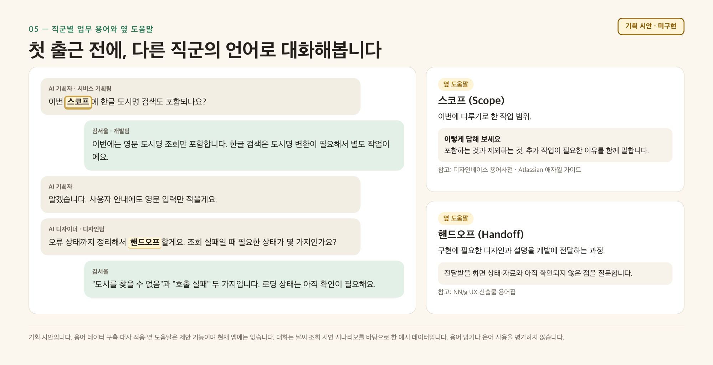

> **삽입 가이드:** AI 동료의 용어가 포함된 발언 → 용어 클릭 → 쉬운 설명과 예시 → 사용자의 작업 설명을 한 화면에 보여줍니다. 실제 화면이 없다면 ‘기획 시안’으로 표시합니다.

### 대화를 위한 설계 원칙

- 사용자가 먼저 설명하고 AI는 한 번에 핵심 질문 하나를 합니다.
- 타 부서의 업무에 필요한 것을 묻고, 기술 퀴즈나 일방적인 강의로 바꾸지 않습니다.
- 충분히 설명하면 마무리합니다. 막히면 작은 질문·힌트를 제공하고, 답하지 못한 내용은 보완 항목으로 남겨 재보고를 요청합니다.
- 말의 유창함을 실력으로 평가하지 않고 텍스트·화면 등 다양한 설명을 허용합니다.
- 사용자가 설명한 내용과 실제 자료에서 관찰한 내용을 구분합니다.

실제 제출물 분석은 대화를 구체화하는 보강 기능입니다. 자료가 없어도 설명 기반 대화는 가능하되, 읽지 않은 링크나 실행하지 않은 코드를 검증했다고 말하지 않습니다. 특정 기업의 합격 가능성·전체 역량을 판정하지 않습니다.

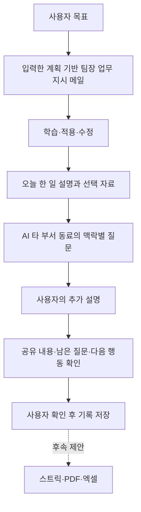

*제안 흐름이며 현재 구현 완료 상태를 뜻하지 않습니다.*

기술 설계는 웹 화면 → 서버의 AI 요청 중계 → 역할별 프롬프트와 맥락 전달 → 응답 형식 검증 → 사용자 확인·저장입니다. 같은 모델에 역할과 맥락을 다르게 제공하는 구성을 우선 검토합니다. Upstage Solar는 후보이며 실제 모델·버전은 품질·지연·비용 시험 후 확정합니다.

API 키는 서버에서 관리합니다. AI에 전달되는 설명·자료 범위를 안내하고, 실패 시 입력을 보존해 수동 보고로 마감할 수 있게 합니다. 텍스트 흐름을 먼저 완성하고 음성·3D는 이후 추가합니다.

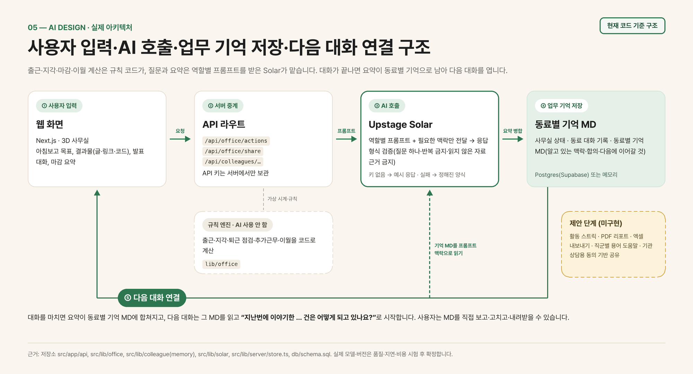

> **삽입 가이드:** 실제 구현과 제안을 구분합니다. 같은 활동에서 설명이 달라질 때 질문도 달라지는 장면, 이미 답한 항목을 반복하지 않는 장면을 함께 제시합니다.

---

### 06 — DIFFERENCE · 차별점
## 나의 작업과 약속을 기억하고,
## 다음 날까지 이어서 확인하는 회사.

혼자 준비하는 청년을 돕는 기존 서비스들은 **일상 루틴 회복**, **작업 착수 지원**, **단발성 스피치 연습**으로 역할이 나뉘어 있습니다. VISION COMPANY는 개발 직무 취업을 준비하는 청년이 **오늘 실제로 만든 결과물**을 매개로, **회사 구조의 실행 관리·타 부서 직무 설명·어제의 약속을 이어가는 기억**을 하나의 일과로 연결합니다.

### 기존 솔루션과 무엇이 다른가요?

| 구분 | 가상회사 커뮤니티<br>([니트컴퍼니](https://neetpeople.kr/neetcompany)) | 작업 동반·집중 툴<br>([Focusmate](https://support.focusmate.com/en/articles/4044432-what-happens-during-a-focusmate-session-do-s-don-ts)) | AI 역할극·스피치 코치<br>([Yoodli](https://support.yoodli.ai/en/articles/11565137-how-to-build-and-customize-roleplays)) | **VISION COMPANY** |
|---|---|---|---|---|
| **핵심 목적** | 고립 해소·일상 루틴·정서적 회복 | 실시간 작업 착수·집중 유지 | 면접·세일즈 발화(스피치) 교정 | **개발 취준생의 실무 실행·직군 간 소통 훈련** |
| **관리 방식** | 다정한 응원·자율 인증 (기수제) | 세션 단위 시간 약속 | 자율적 단발성 연습 | **업무 지시·마감·재보고·이월 추적 (상시)** |
| **소통·피드백** | 동료 간 정서적 지지·일상 공유 | 작업 전후 짧은 목표 공유 | 말투·속도·필러 워드 등 전달력 분석 | **기획·디자인·마케팅 관점의 직무 질문·빈틈 발견** |
| **연습 소재** | 일상 루틴·개인 관심사 | 각자의 작업 (내용 개입 없음) | 설정된 가상 시나리오 | **오늘 내가 실제로 학습·구현한 개발 결과물** |
| **맥락 연속성** | 기수 내 관계 중심 | 세션 종료 시 단절 | 세션별 독립 평가 | **미결 질문·보완 약속을 다음 날까지 기억·재확인** |

- **니트컴퍼니와의 차이 — ‘정서적 회복’이 아닌 ‘개발 실무와 강제 마감’:** 니트컴퍼니가 가상회사 형식으로 무업 기간의 고립 해소와 일상 회복 수요를 증명했다면, VISION COMPANY는 그 포맷을 **개발 직무 취업 준비에 특화한 상시 AI 소프트웨어**로 설계합니다. 다정한 응원이 핵심인 커뮤니티에 엄격한 마감 독촉·추가근무·직무 압박을 도입하면 기존 목적과 충돌하지만, VISION COMPANY는 처음부터 실무형 강제성과 직군 간 소통 훈련에 집중합니다.
- **Yoodli와의 차이 — ‘어떻게 말했는가’가 아닌 ‘무엇을 만들었고 빈틈이 무엇인가’:** Yoodli 같은 AI 역할극 도구는 가상의 상황을 설정해 발화 속도·어조 등 스피치 전달력을 교정하는 단발성 연습에 강점이 있습니다. VISION COMPANY는 말의 유창함을 평가하지 않습니다. 오늘 내가 실제로 구현한 개발 작업의 **목적·가능 범위·제약·예외 상황**을 타 부서 동료에게 설명하며 구현의 빈틈을 찾습니다.
- **Focusmate와의 차이 — ‘시간 약속’에서 ‘결과물과 재보고 추적’까지:** 작업 세션의 시작과 끝을 함께하는 데 그치지 않고, 아침에 합의한 작업 범위가 저녁 결과물 제출과 타 부서 공유, 다음 날 이월 해소까지 이어지도록 관리합니다.

### 이 흐름 전체가 하나의 일과로 이어집니다.

**이번에 확인한 서비스의 공식 소개에서는 아래 흐름 전체를 하나의 핵심 경험으로 제시하는 사례를 확인하지 못했습니다.**

1. **내가 정한 실제 준비 과제**를 앱에 구체적으로 입력한다.
2. 팀장에게 **사내 업무 지시 메일**을 받고, 출근·마감·재보고 규칙 안에서 수행한다.
3. 아침부터 공유할 상대와 목적을 알고, **설명하기 위해 공부하고 작업**한다.
4. AI 디자이너·기획자·마케터에게 결과를 설명하며 **다른 직군의 질문과 업무 언어에 응답**한다.
5. 동료가 이전 설명과 약속을 기억하고, **미완료와 남은 질문을 다음 날 다시 확인**한다.
6. 수행·설명·재보고·수정 과정이 **하나의 성장 기록**으로 남는다.

| 요소 | 사용자에게 필요한 이유 | 서비스가 이어가는 행동 |
|---|---|---|
| 회사의 구조 | 혼자 정해야 했던 하루에 시작·보고·마감 제공 | 오늘 공유할 상대와 결과를 아침부터 확정 |
| 끝까지 확인하는 관리 | 계획이 밀렸을 때 흐지부지 끝나지 않게 함 | 독촉·추가근무·이월·재보고 추적 |
| 업무를 기억하는 동료 | 매번 배경을 다시 설명하지 않고 작업을 이어감 | 이전 공유 내용과 남은 질문에서 대화 시작 |
| 연결된 활동 기록 | 꾸준함과 개선을 구체적인 사례로 설명 | 최초 목표부터 수정·해소까지 근거 연결 |

### 월요일의 미완료가, 화요일의 시작이 됩니다.

별도의 연습을 위해 새로운 가상 상황을 만드는 대신, **자신이 실제로 준비하는 일**을 바탕으로 함께 일하는 방식을 연습합니다. 내 작업과 약속을 기억하는 동료가 있으니, 준비가 매일 처음부터 시작되지 않습니다.

**월요일 — 공유와 발견**

> 사용자: “로그인 기능을 만들었습니다.”  
> AI 기획자: “실패한 경우 사용자에게 어떤 안내가 나오나요?”  
> 사용자: “아직 없습니다. 내일 오류 안내를 추가하겠습니다.”

작업은 제출됐지만 보완 약속은 미결 상태로 남습니다. 다음 활동일 이월 기록과 연결합니다.

**화요일 아침 — 약속 확인**

> AI 팀장: “어제 이월한 로그인 실패 안내가 남아 있습니다. 오늘 완료 범위와 재보고 시각을 확정해주세요.”

**화요일 저녁 — 이어지는 공유**

> AI 기획자: “어제는 실패 안내가 없다고 했죠. 오늘은 사용자에게 어떻게 알려주나요?”

**주간 기록 — 변화 확인**

`첫 결과물 → 동료의 질문 → 보완 약속 → 재보고 → 수정 결과`

*위 대화는 기억·재보고 기능의 기획 시나리오입니다. 실제 동작이나 효과 검증 사례는 아닙니다. 실제 자료를 읽지 않았다면 동작 검증이 아니라 사용자 설명 기록으로 표시합니다.*

그 결과를 스트릭 하나로 평가하지 않습니다. 약속을 어떻게 수행했는지, 다른 직군에게 어떻게 설명했는지, 질문과 피드백을 받고 무엇을 개선했는지를 근거로 남깁니다. 선택형 PDF·엑셀 내보내기는 이 기록을 자신의 성실성과 소프트스킬을 설명하는 보조 자료로 활용하기 위한 제안입니다.

*확인 범위: 위 비교는 링크한 공식 소개에서 확인한 핵심 경험을 기준으로 합니다. 시장 전체에 동일한 서비스가 없다는 의미나 경쟁 제품의 기능 부재를 단정하는 주장은 아닙니다. 우리의 결합 경험이 더 유용한지는 실제 완주·재보고·연속 대화·수정 사례로 검증합니다.*

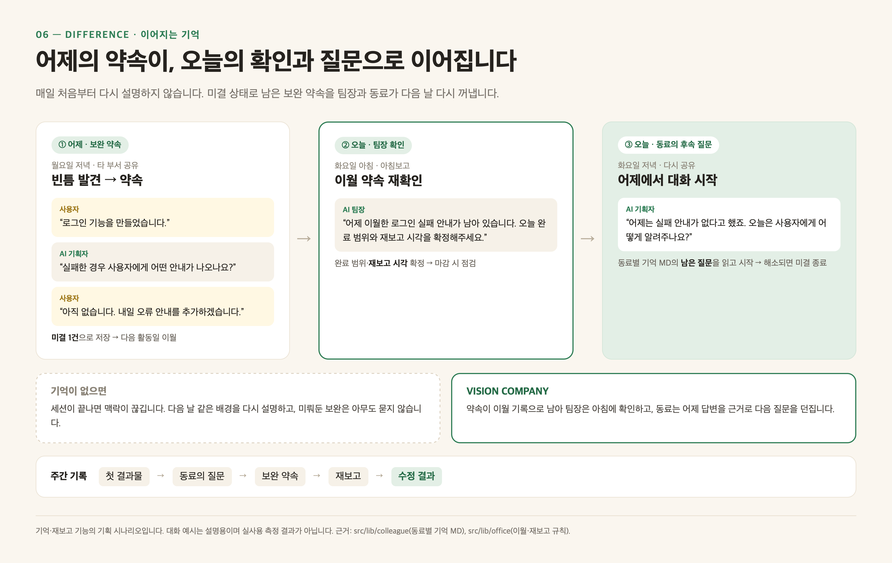

> **삽입 가이드:** 같은 과제로 월요일 공유 → 저장된 미결 항목 → 화요일 팀장 확인 → 동료의 후속 질문 → 수정 기록을 나란히 보여줍니다. 구현 전에는 기획 시안으로 표시합니다. 실제 실험에서는 반복 설명 횟수·미결 해소·재보고를 관찰합니다.

---

### 07 — VALIDATION · 현장 검증
## 문제는 인터뷰로.
## 변화는 실제 사용으로.

인터뷰 15명은 문제 탐색의 근거입니다. AI 동료에게 설명하는 방식이 실행과 방향 확인에 도움이 되는지는 추가 검증해야 합니다. 직무 관련 질문을 받는 경험을 제공하되, 취업 효과까지 입증한 것으로 확대하지 않습니다.

| 검증 질문 | 관찰할 기록 |
|---|---|
| 실제로 시작하는 데 도움이 되는가 | 보고 후 착수 시간·중단 이유 |
| 목표가 결과물로 이어지는가 | 확정 과제 대비 제출 현황 |
| 설명이 오늘의 활동 정리에 도움이 되는가 | 설명 전후 목적·결과·제약의 구체화와 발견 사례 |
| 보완이 이해와 적용으로 이어지는가 | 다시 설명한 내용·후속 적용 과제의 변화, 전문가 검토 |
| 동료의 질문이 맥락에 맞는가 | 후속 업무 관련성·답변 반영·반복 질문 여부 |
| 업무 표현이 실제 대화에 도움이 되는가 | 도움말 후 적절한 응답·되묻기·범위 합의 사례, 용어 과다 사용 부담 |
| 다음 날에도 작업이 이어지는가 | 정확한 기억 참조·미결 해소·재보고·잘못된 기억과 반복 설명 횟수 |
| 직무 연결 설명이 유용한가 | 사용자 응답·전문가의 근거 검토 |
| 관리가 실행으로 이어지는가 | 독촉 후 착수·제출·재보고 완료, 보고 부담과 이탈도 함께 관찰 |
| 내보낸 기록이 채용 참고 자료로 유용한가 | 채용·직무 담당자의 실제 검토 의견 |

첫 실험은 짧은 보고와 핵심 질문 1~2개로 시작하고, 관찰 기간·성공 기준을 사전에 정합니다. AI의 칭찬이나 점수만으로 이해도와 학습 효과를 판정하지 않습니다.

현직자 피드백은 실제 결과물 기반 피드백, 직무 연결, 관리 부담 완화, 핵심 흐름 우선 구현, 외부 실행 환경 보강을 요구했습니다. 이번 설계에 반영했지만 제품 개선 완료나 효과 검증을 의미하지 않습니다.


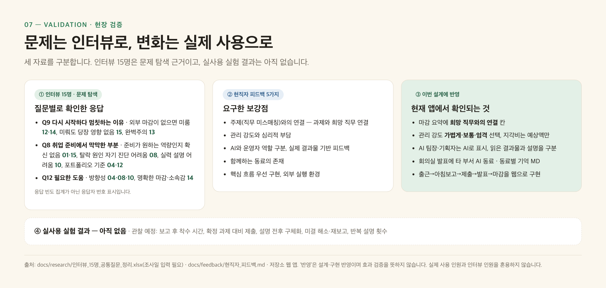

> **삽입 가이드:** 최신 인터뷰 15명 집계·피드백 원문·실험 결과를 구분합니다. 실제 사용 인원과 인터뷰 인원을 혼용하지 않습니다. 최신 기록의 조사일·표본 구성·원문 위치를 추가합니다.

---

### 08 — PUBLIC MODEL · 사업화
## 서울시 청년 사업의 공백기를 메우고,
## 현장 상담의 근거를 쌓습니다.

서울시는 **청년취업사관학교(SeSAC)**를 통한 직무 교육, **미래 청년 일자리**를 통한 일경험, **서울청년센터**를 통한 구직 상담 등 청년 지원 정책을 폭넓게 운영하고 있습니다.

하지만 **교육·일경험 진입 전 혼자 준비하는 기간**, **수료 후 취업 전까지의 공백기**, **정원 제한으로 오프라인 프로그램에 참여하지 못한 개발 취준생**은 다시 혼자 루틴을 지켜야 하는 사각지대에 놓입니다. VISION COMPANY는 이 공백기를 메우는 **서울시 공공 도입형(B2G) AI 가상회사 모델**을 제안합니다.

### 기존 서울시 지원 사업과의 연결 구조

| 서울시 기존 지원 영역 | 현장의 빈틈 | VISION COMPANY 도입 시 기대 역할 |
|---|---|---|
| 직무 교육 (예: SeSAC) | 수료 후 취업 전까지 혼자 남는 공백기에 실행 루틴 저하 | 수료생 대상 사후 관리(출근·마감·타 부서 설명)로 취업 준비 지속성 유지 |
| 일경험 (예: 미래 청년 일자리) | 첫 직무 투입 전, 다른 직군과 협업·소통해 본 경험 부족 | 일경험 진입 전 AI 기획·디자인·마케팅 동료와 사전 직무 소통 훈련 |
| 청년 상담 (예: 서울청년센터) | 구직자의 실제 준비 과정과 막힌 지점을 파악할 구체적 자료 부족 | 이용자 동의 하에 공유된 수행·설명·보완 기록을 맞춤형 상담 참고 자료로 활용 |

### 운영 주체별 역할

참여 여부와 외부 공유는 이용자가 직접 선택하되, 참여 기간에 합의한 출근·보고·마감은 의무로 관리합니다.

| 주체 | 제안 역할 |
|---|---|
| 청년 (개발 취준생) | 무료 참여·목표 설정·활동 수행·설명·상담용 기록 공유 범위 선택 |
| 서울시·청년지원기관 | 참여자 모집(공백기·대기 청년 연계)·동의 기반 상담 활용·운영 지원 |
| 운영팀 | 서비스 제공·AI/서버 운영·사용 지원·장애 대응 |
| 직무 전문가 | 직군별 질문 기준·피드백·직무 연결의 유용성 검토 |

기관은 이용자가 동의해 공유한 기록만 상담에 참고합니다. 이용자의 스트릭이나 AI 판단으로 지원금·프로그램 자격을 자동 결정하는 평가 모델은 전제로 하지 않습니다.

### 수익 모델 및 도입 단계

기존 기획서의 **개인 월 구독 모델**과 **지각비 가상 정산**을 폐기하고, 구직 청년의 비용 부담을 없앤 **공공 도입·운영 계약 모델**로 재설계했습니다.

1. **1단계 — 소규모 기간형 실증 (Pilot):** 서울시 산하 청년지원기관 또는 교육 수료생 그룹을 대상으로 4~8주 기수제 실증을 진행해 완주율·상담 활용도·담당자 업무량을 검증합니다.
2. **2단계 — 기수별·연간 운영 계약 (B2G SaaS):** 실증 결과를 바탕으로 참여 인원·운영 기간에 따른 **기수별 운영 계약** 또는 **연간 기관 라이선스** 형태로 공급합니다.

운영 비용에는 AI API·음성 전사·서버·저장 비용과 이용 지원·현직자 질문 검토 시간이 포함됩니다. *현재 서울시 및 산하 기관과의 도입 의향·계약·가격은 확정되지 않은 제안 단계입니다.*

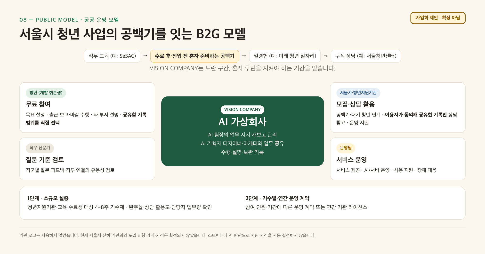

> **삽입 가이드:** 서울시 기존 사업(교육·일경험·상담) 사이의 공백기를 VISION COMPANY가 잇는 구조도와, 동의 기반 기록 공유 흐름을 그립니다. 실제 협력이 없는 기관 로고는 사용하지 않습니다.
---

### 09 — GROWTH RECORD · 기록과 확산계획
## 하루가 쌓이면,
## 나의 준비를 보여줄 근거가 됩니다.

### 성실성과 소프트스킬, 행동의 근거로 보여줍니다.

| 연습할 역량 | 남기는 행동 기록 | 지원자가 설명할 수 있는 내용 |
|---|---|---|
| 목표·마감 관리 | 확정 계획·제출 시각·미완료 재보고·이월 후 해소 | 약속한 일을 어떻게 수행하고 미완료에 대응했는가 |
| 다른 직군에 업무 설명 | 목적·가능 범위·제약에 대한 설명과 대화 원문 | 디자이너·기획자·마케터가 이해하도록 무엇을 전달했는가 |
| 질문에 대한 응답 | 예상 밖 질문·답변·미확인 사항의 후속 확인 | 모르는 점을 구분하고 어떻게 확인했는가 |
| 제약·대안 전달 | 범위 밖 요청의 이유·대안·합의 기록 | 불가능한 요구에 어떤 대안을 제시했는가 |
| 피드백 반영 | 첫 결과물·수정 이유·재제출 연결 | 질문과 피드백을 어떻게 작업에 반영했는가 |

기록에는 일시·활동·근거를 연결하고 사용자 진술·AI 요약·자료 관찰을 구분합니다. AI 동료와의 모의 대화임을 표시하며 실제 회사 협업 이력으로 포장하지 않습니다. 리포트의 유용성과 실제 직무 수행으로의 전이는 사용자·현직자 검토가 필요합니다.

### 활동 스트릭 — 꾸준함을 돌아보는 장치

연속 활동일과 주간 참여 이력을 보여주는 기능을 제안합니다. 출근만으로 채우는 대신 목표·결과·보고 등 활동 인정 조건을 명확하게 정하고 검증합니다.

**스트릭은 서비스 안의 활동 지속성을 보여줍니다. 사람 전체의 성실함이나 직무 능력을 인증하는 지표는 아닙니다.** 휴식·재시작이 불이익이나 낙인으로 이어지지 않도록 주간 목표와 복귀 경험도 함께 설계합니다. 성실도 티어는 별도 검증 전까지 확정하지 않습니다.

### PDF — 대표 활동을 고르는 제출용 리포트

사용자가 공유할 활동을 선택해 다음 내용을 정리하는 기능을 제안합니다.

- 활동 기간과 지속 활동 요약
- 선택한 목표·대표 결과물·원본 링크
- 다른 직군에게 전달한 목적·완료 범위·제약·사용자 가치와 질문 응답 사례
- 피드백을 반영한 수정 사례와 미완료 후 재보고·해소 이력
- AI 생성 내용과 검증 한계

회사 지원 시 선택적으로 첨부하는 **보조 포트폴리오**를 지향합니다. 채용 효과와 기업 활용 가능성은 아직 검증되지 않았습니다. 다운로드한 파일 자체가 공인 인증이나 변조 방지 증명이 되는 것은 아닙니다.

### 엑셀 — 상세 활동을 돌아보는 이력

날짜·목표·완료 기준·수행 상태·결과물 링크·설명 요약·피드백·수정·다음 행동을 표로 내보내는 기능을 제안합니다. 미완료도 별도 상태로 남겨 사용자가 자신의 패턴을 확인하게 합니다.

공유 리포트에는 비공개 대화·개인적인 중단 사유를 기본 포함하지 않고, 공개 전 미리보기와 항목 선택을 제공하는 방향입니다.

### 단계별 확산

| 단계 | 먼저 확인할 것 |
|---|---|
| 01 핵심 일과 | 출근부터 결과물·피드백까지 실제 완주 |
| 02 설명 대화 | 질문의 적절성·발견한 빈틈·보고 부담 |
| 03 기록과 내보내기 | 기록 정확성·선택 공유·리포트 유용성 |
| 04 기관 실증 | 상담 활용·운영 비용·재참여 |

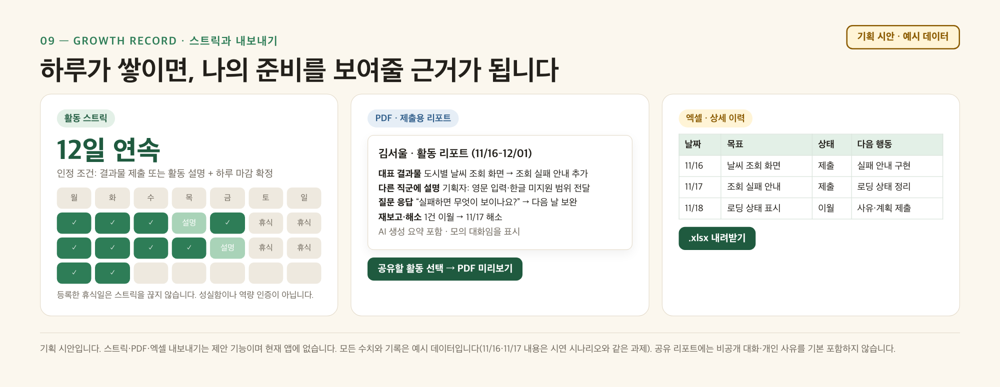

> **삽입 가이드:** 스트릭·PDF·엑셀을 ‘제안 기능’으로 표시합니다. 예시 수치는 가상 데이터라고 명시합니다. 구현 후에는 실제 내려받은 결과와 서비스 원본 기록을 대조합니다.

---

### 10 — SEOUL FIT
## 일경험의 기회에 앞서,
## 준비하는 하루부터.

청년취업사관학교(SeSAC)는 서울시와 서울경제진흥원 등이 운영하는 인재양성 사업이며, 과정에 따라 서류·레벨테스트·면접 등 선발 절차가 있습니다. VISION COMPANY는 교육 지원 전의 준비 기간에도 사용하고, 학습·결과·설명 기록을 자기소개와 면접 준비에 활용하는 방향을 제안합니다. 자료 첨부 가능 여부는 과정별 지원 양식에 따르며 공식 가점·인증·제휴를 주장하지 않습니다. 경쟁률은 확인 없이 수치화하지 않습니다. [서울시 소개](https://www.seoul.go.kr/myseoulstory/sesac/), [공식 FAQ](https://aisesac.seoul.kr/faq).

서울시 미래 청년 일자리 사업 등은 청년의 일경험을 지원합니다. VISION COMPANY는 일경험 진입 전 청년이 일과를 만들고 준비 활동과 결과물을 축적하는 과정을 보완하는 방향을 제안합니다.

| 공식 근거 | 팀의 연결 제안 |
|---|---|
| [2026년 미래 청년 일자리 참여자 모집 공고](https://news.seoul.go.kr/gov/archives/577865) | 일경험을 준비하는 기간의 활동 지원 |
| [서울시 미래 청년 일자리 확대 소개](https://mediahub.seoul.go.kr/archives/2017354) | 직무 분야에 맞는 질문·결과물·다음 준비 검토 |

청년에게는 자신의 활동을 설명할 자료를, 기관에는 동의 기반 상담 참고 자료를 제공하는 가능성을 검토합니다. 이는 팀의 제안이며 서울시의 공식 도입·인증·채용 연계가 확정된 것은 아닙니다. 가상회사 활동을 실제 근무 경력으로 표시하지 않습니다.

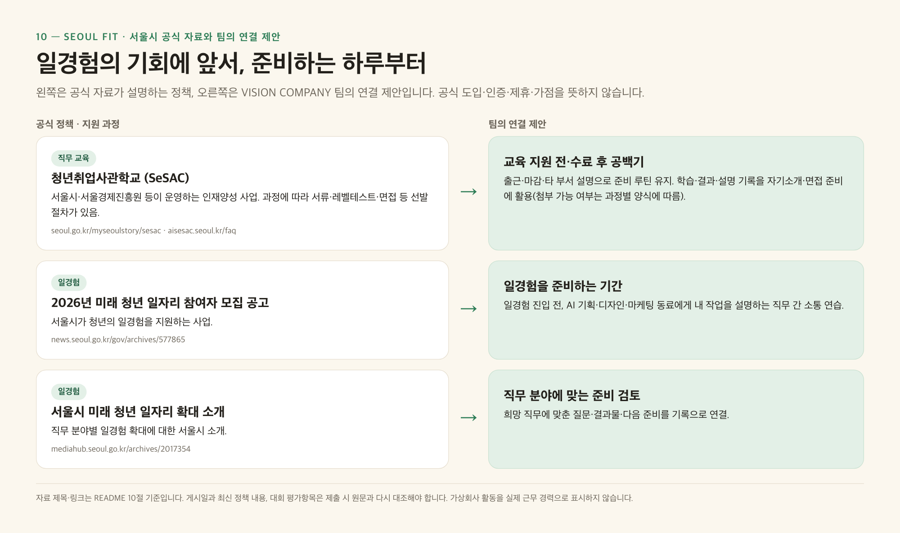

> **삽입 가이드:** 공식 자료의 제목·게시일·관련 문단·링크를 넣습니다. 정책 내용과 팀의 연결 해석을 분리합니다. 대회 공식 평가항목과 최신 정책 내용은 제출 시 다시 대조합니다.

---

### 11 — VISION · 마무리
## 오늘 배운 것을 설명하고,
## 내일 배울 것을 발견합니다.

혼자서는 시작하고 끝내기 어렵다는 것. 지금의 준비가 취업에 도움이 되는지 모르겠다는 것.

VISION COMPANY는 그 두 가지 어려움에서 출발했습니다.

**스스로 목표를 정하고. 직접 해보고. 동료에게 설명하고. 다음 행동을 찾습니다.**

그 하루가 쌓이면, 무엇을 준비하고 어떻게 개선했는지 돌아볼 기록이 남습니다.

### 꾸준히 실행하고, 다른 직군과 소통하는 준비.
### 그 과정을 보여줄 수 있는 기록.

**VISION COMPANY — 첫 개발 직장 전, 함께 일하는 하루를 연습합니다.**

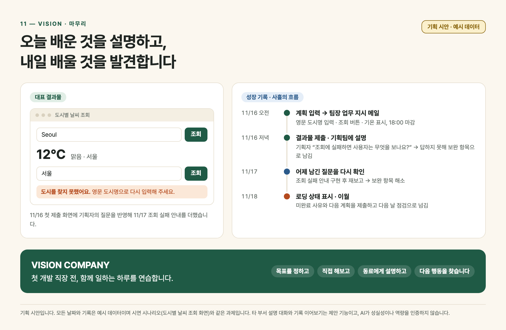

> **삽입 가이드:** 동일 사용자의 목표·결과물·설명·수정 기록을 연결합니다. 새 기능의 시안은 실제 사용 화면과 구분합니다.

---

### 12 — APPENDIX · 부록
## 실행과 근거를 확인하세요.

### 구현과 제안 범위

| 항목 | 현재 확인 수준 |
|---|---|
| 인터뷰 | [15명·공통 질문 13개 요약 자료](./docs/research/인터뷰_15명_공통질문_정리.xlsx) 추가. 조사일·모집 방식·공개 동의 범위 확인 필요 |
| 출근·아침보고·결과물·주간 피드백 | 기존 기획 범위. 현재 빌드 완주·실제 입력 범위 확인 필요 |
| macOS 앱·배포 ZIP | 파일 존재 확인. 실행 검증과 외부 접근성은 별도 |
| AI 팀장·디자이너·기획자·마케터 역할 대화 | 핵심 신규 설계. 역할별 구현 상태·맥락별 질문 품질·사용 효과 확인 필요 |
| 동료의 업무 맥락 기억 | 신규 제안. 저장·관련 기억 전달·사용자 수정·삭제·다음 날 재보고 연결 확인 필요 |
| 직군별 업무 용어·옆 도움말 | 제안. 용어 출처·맥락별 뜻·대사 반영·도움말 사용성 확인 필요 |
| 희망 직무·역량 연결 | 확장 제안 |
| 활동 스트릭·성실도 티어 | 제안. 인정 조건·공정성 검증 필요 |
| PDF·엑셀 내보내기 | 새 제안. 현재 생성 기능 완료를 주장하지 않음 |
| 기관 도입·채용 활용 | 제안. 계약·인증·채용 효과 미확인 |

### 참고 자료

| 자료 | 근거 범위 |
|---|---|
| 업로드 SKILL.md | 표지→문제→사례→데모→기술→차별점→검증→사업화→확산→서울 FIT→마무리→부록의 12단계 |
| VISION COMPANY 기획서 pp.2–3 | 문제 발견·기존 인터뷰 요약 |
| 기획서 pp.4–7 | 사용자 일과·운영 규칙·기술 설계 |
| 기획서 p.8 | 기존 사업 모델·1주 실험 계획 |
| 현직자 피드백 report.pdf pp.1–3 | 직무 연결·관리 부담·결과물 검토·핵심 흐름·배포 보완 |
| [최신 인터뷰 15명 정리](./docs/research/인터뷰_15명_공통질문_정리.xlsx) | 공통 질문별 응답 요약 및 정리 기준. 조사일·모집 방식·세부 구성은 별도 확인 필요 |
| 서울시 공식 자료 | 10절 링크 참고 |

### 인터뷰 자료의 정리 및 취급

참여자는 실명·별칭 대신 01~15번으로 표시하고 답변을 요약했으며, 미응답은 빈칸으로 남겼습니다. 파일의 「정리 기준」 시트에서 편집 범위를 확인할 수 있습니다.

실명·별칭은 제거되어 있으나 건강·가족·경제 상황 및 구체적인 경험이 포함되어 있습니다. 현재 비공개 저장소에서 관리하며, 외부 공유나 저장소 공개 전에는 재식별 가능 정보와 민감한 응답을 추가 검토하고 공개 동의 범위를 확인해야 합니다.

### 실행 정보

| 항목 | 최종 제출 정보 |
|---|---|
| 저장소·제출 커밋 | [입력 필요] |
| 접속 주소·시연 영상·데모 계정 | [입력 필요] |
| 설치·실행 방법 | [실제 검증한 명령 입력] |
| 실제 모델·기술 버전·저장소 | [입력 필요] |
| 필수 환경변수 | [변수명만 입력, 비밀키 제외] |
| 팀원별 기여 | [실제 수행 내용 입력] |

### 제출 전 확인

- [ ] 인터뷰 15명 최신 기록과 공개 동의를 확인했다.
- [ ] 실제 구현·기획 시안·확장 제안을 구분했다.
- [ ] 핵심 흐름과 실패 시 대체 입력을 실제 실행했다.
- [ ] AI가 읽은 정보와 확인하지 못한 부분을 명시했다.
- [ ] 보고 소요 시간·심리적 부담·다시 시작하는 경험을 점검했다.
- [ ] 내보내기를 구현했다면 서비스 기록과 PDF·엑셀 값이 일치하는지 확인했다.
- [ ] 외부 기기에서 핵심 기능과 제출 링크가 열린다.
- [ ] 이미지·GIF·출처·정책·대회 평가항목을 최종 대조했다.

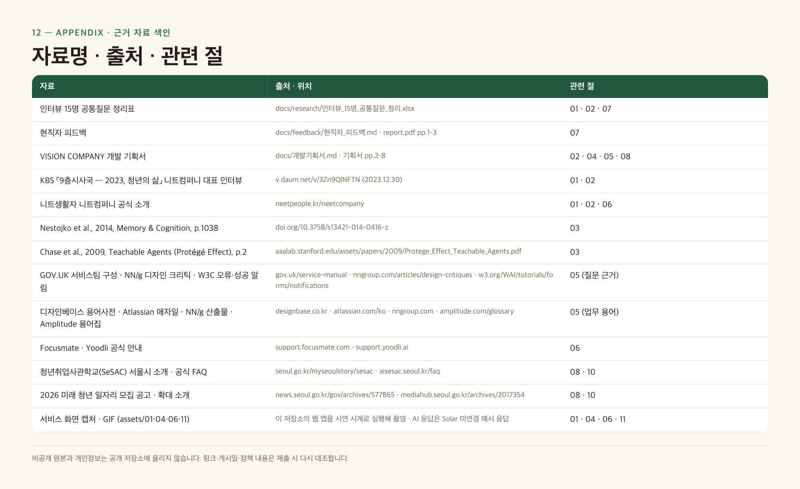

> **삽입 가이드:** 자료명·페이지·관련 절을 한 장에 정리합니다. README 옆 `assets/` 폴더에 각 파일을 저장하면 상대경로로 표시됩니다. 연구 발췌 캡처 2개는 실제 파일이며, 나머지 서비스 이미지는 추가할 자리표시자입니다. 비공개 원본과 개인정보는 공개 저장소에 올리지 않습니다.

### 저장소 실행과 개발 문서

저장소의 기존 실행 안내를 보존합니다. 아래 명령은 이번 문서 교체 작업에서 실행 검증하지 않았습니다.

```bash
npm install
cp .env.example .env.local
npm run dev
npm test
```

환경변수와 실제 처리 방식은 [.env.example](./.env.example) 및 아래 개발 문서를 확인하세요.

- [백엔드 개발 계획](./docs/backend/개발계획_Vercel.md)
- [API 안내](./docs/backend/API.md)
- [데이터 모델](./docs/backend/데이터모델.md)
- [현직자 피드백](./docs/feedback/현직자_피드백.md)
- [Git 협업 규칙](./CONTRIBUTING.md)
