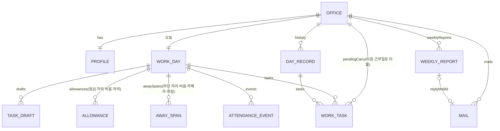

# 데이터 모델

> ⚠ 이 문서는 개정 전(근태·지각·추가근무) 모델 기준입니다. 개정 기획서(2026-11-21) 반영 뒤의 모델은
> `src/lib/office/models.ts`와 `docs/backend/API.md`, 개발기획서 4.5절을 보세요. 저장 방식(JSONB 한 줄)은 그대로입니다.

피드백("ERD가 없고 상태 변화가 문장으로만 정의되어 있다")에 대한 정리. 코드 기준 정의는 `src/lib/office/models.ts`.

## 저장 방식

참여자 한 명의 회사 상태 전체를 **한 줄(JSONB)** 로 저장한다. 규칙 엔진의 상태 객체를 그대로 읽고 쓸 수 있고,
해커톤 기간에 테이블을 여러 개 맞추는 부담이 없다.

```sql
CREATE TABLE IF NOT EXISTS offices (
  id            TEXT PRIMARY KEY,      -- 브라우저 쿠키 office_id (UUID)
  state         JSONB       NOT NULL,  -- OfficeState 전체
  clock_anchor  BIGINT      NOT NULL,  -- 가상 시계를 마지막으로 맞춘 실제 시각(ms)
  created_at    TIMESTAMPTZ NOT NULL DEFAULT now(),
  updated_at    TIMESTAMPTZ NOT NULL DEFAULT now()
);
```

시각은 모두 epoch 밀리초(number), 날짜는 `{year, month, day}`(KST 기준)다.

## 논리 구조(ERD)



## 상태 값

### 하루 단계 `WorkDay.phase`

```
beforeCheckIn ──checkIn──▶ morningPT ──confirmTasks──▶ working
     │ (18:00까지 출근 없음)       │ (18:00, 'PT 미진행')     │ (18:00)
     ▼                            └──────────┬──────────────┘
 absentCandidate                              ▼
 (다음 근무일로)                        checkoutReview
                                 submitCheckout │
                    ┌──── 2·3단계 없음 ─────────┼──── 2·3단계 남음 ────┐
                    ▼                                                ▼
                   off ◀── endOvertimeEarly ── overtime ◀─(19:00)── dinner
                    ▲                             │ (22:00)
                    └── submitOvertimeReview ── overtimeReview
```

### 업무 `WorkTask.status`

| 값 | 뜻 | 바뀌는 때 |
| --- | --- | --- |
| `open` | 진행 중 | 확정 직후, 체크 해제 |
| `done` | 완료 | 체크(근무·점검·저녁·추가근무·종료 점검 중) |
| `carried` | 다음 근무일로 이월됨 | 1단계 이월 보고, 22:00 종료 점검, 보충근무 미이행, 금요일 장면 |

이월하면 원래 업무는 `carried`가 되고, **새 id로 복사**해 `pendingCarry`에 넣는다.
복사본은 `carriedFrom`(처음 확정한 날)을 유지하고 `carryCount`를 1 늘린다. 다음 근무일 아침 초안 맨 앞에 들어가며 지울 수 없다.

### 업무 중요도 `level`

| 값 | 이름 | 18:00에 미완료면 |
| --- | --- | --- |
| 3 | 필수 마감 | 19:00~22:00 추가근무에서 가장 먼저 |
| 2 | 당일 완료 | 19:00~22:00 추가근무 |
| 1 | 이월 가능 | 이유·계획을 적어 이월 보고 후 정시 퇴근 |

### 허용 시간 `Allowance.kind`

| 값 | 길이 | 조건 |
| --- | --- | --- |
| `lunch` | 60분(퇴근 시각을 넘지 않음) | 근무 중, 하루 한 번 |
| `away` | 15분(퇴근/추가근무 종료를 넘지 않음) | 근무 중·추가근무 중, 사유 필수 |
| `dinner` | 18:00~19:00 | 점검에서 추가근무 배정 시 자동, 먼저 끝낼 수 없음 |

허용 시간은 **등록된 종료 시각에 만료**한다('다음 정각'으로 건너뛰어도 같음).

### 자리 구간 `AwaySpan.kind`

| 값 | 뜻 |
| --- | --- |
| `unauthorized` | 허용 시간 밖에서 자리가 빔 → 근무 중 자리 비움 |
| `cameraOff` | 카메라 꺼짐 → 자리 비움으로 세지 않고 "확인 후 확정" |

근무 중·추가근무 중이고 허용 시간이 아닐 때만 연다. '다음 정각'으로 건너뛴 시간은 세지 않는다.

### 출근 판정 `Attendance`

`onTime`(09:00:59까지) / `late`(09:01부터) / `absentCandidate`(18:00까지 출근 없음).
지각 1점, 결근 후보 3점, 월 2점까지 0원, 초과 1점당 1,000원, 월 최대 5,000원(예상액만 표시).

### 추가근무 결과 `OvertimeOutcome`

`completed`(다 끝냄) / `ranToEnd`(22:00까지, 남은 건 이월) / `abandoned`(먼저 종료 = 보충근무 미이행).

### 메일 `Mail.kind` → 분류 배지

| kind | 배지 |
| --- | --- |
| welcome | 인사 |
| notice | 공지 |
| tasksConfirmed, carryReport, carryAccepted | 업무 |
| lunchRequest, lunchApproval, overtimeAssigned, overtimeResult, supplementMissed, offConfirmed, attendance | 근태 |
| weeklyReport | 주간보고 |
| weeklyFeedback | 주간 피드백 (`isWarm: true`, `replySource: solar \| localTemplate`) |

## 나중에 테이블을 나누고 싶다면

여러 참여자의 지표(1주 시범 운영 결과 등)를 모아 볼 때는 `history`(DayRecord)를 별도 테이블로 복사하는 보고용 작업을 추가한다.
규칙 엔진은 지금처럼 JSONB 한 줄을 읽고 쓰는 구조를 유지하는 것이 안전하다.
