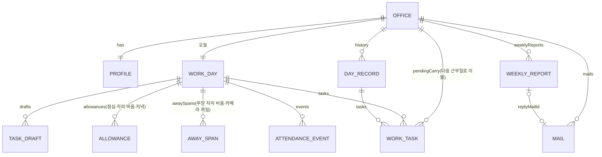

# 데이터 모델

피드백("ERD가 없고 상태 변화가 문장으로만 정의되어 있다")에 대한 정리. 코드 기준 정의는 `src/lib/office/models.ts`.

## 저장 방식

참여자 한 명의 회사 상태 전체를 **한 줄(JSONB)** 로 저장한다. 규칙 엔진의 상태 객체를 그대로 읽고 쓸 수 있고,
해커톤 기간에 테이블을 여러 개 맞추는 부담이 없다.

```sql
CREATE TABLE IF NOT EXISTS offices (
  id            TEXT PRIMARY KEY,      -- 브라우저 쿠키 office_id (UUID)
  state         JSONB       NOT NULL,  -- OfficeState 전체
  clock_anchor  BIGINT      NOT NULL,  -- 가상 시계를 마지막으로 맞춘 실제 시각(ms)
  created_at    TIMESTAMPTZ NOT NULL DEFAULT now(),
  updated_at    TIMESTAMPTZ NOT NULL DEFAULT now()
);
```

시각은 모두 epoch 밀리초(number), 날짜는 `{year, month, day}`(KST 기준)다.

## 논리 구조(ERD)



## 상태 값

### 관리 강도 `EmployeeProfile.enforcement`

참여자가 입사 때 고르고 설정에서 언제든 바꾼다. 기본은 `standard`.

| 장치 | `light` 가볍게 | `standard` 보통 | `strict` 엄격 |
| --- | --- | --- | --- |
| 지각·결근 후보, 지각비 예상액 | 없음 | 있음 | 있음 |
| 착석 확인(`observePresence`) | 없음 | 있음 | 있음 |
| 점심·자리 비움 등록 | 없음 | 있음 | 있음 |
| 허용 밖 자리 비움 | — | 15분 넘으면 기록 | 짧아도 기록·경고 |
| 마감 시각 퇴근 점검·추가근무 | 없음 | 있음 | 있음 |
| 마감 시각 전 마감 | 언제든 | 2·3단계가 남으면 불가 | 같음 + 사유 필수 |
| 과제 중요도 | 숨김(1로 저장) | 필수 | 필수 |

`WorkDay.level`은 그날 출근할 때의 강도, `WorkDay.lowered`는 '오늘만 한 단계 낮추기'. 실제 적용 강도는 `lowered`면 한 단계 아래.

### 하루 단계 `WorkDay.phase`

가볍게는 사용자 행동으로만 넘어간다.

```
beforeCheckIn ─checkIn─▶ morningPT ─confirmTasks─▶ working ─startSharing─▶ sharing ─endSharing─▶ checkoutReview ─confirmReview─▶ off
                                                     └──────── endSharing(공유 건너뛰기) ───────────▲
```

보통·엄격은 마감 시각(`activityEnd`)에 시각으로 넘어가는 단계가 더 있다.

```
beforeCheckIn ──(마감 시각까지 출근 없음)──▶ absentCandidate=true (다음 활동일로)
morningPT·working ──(마감 시각)──▶ checkout ─submitCheckout─┬─ 2·3단계 없음 ─▶ working(점검 완료) ─▶ 공유·마감
                                                            └─ 2·3단계 남음 ─▶ dinner ─(마감+1h)─▶ overtime ─(마감+4h)─▶ overtimeReview
                                                                                    └──── endOvertime ────┴──── endOvertime ──▶ working(점검 완료) ─▶ 공유·마감
```

가볍게로 낮추면(`lowerToday`·`setEnforcement`) `checkout`·`dinner`·`overtime`·`overtimeReview`에서 바로 `working`으로 돌아온다(`overtime = "lowered"`).

### 과제 `WorkTask.status`

`confirmed` → `in_progress` → `submitted` → (마감 확정) `reviewed`. 제출하지 못한 과제는 마감에서 `adjust`(범위 조정, reviewed) · `carryOver`(이월, incomplete) · `endToday`(오늘 종료, incomplete) 중 하나를 고른다.
이월은 새 id로 복사해 `pendingCarry`에 넣고 `carriedFromTaskId`(맨 처음 과제)·`carryCount`·`level`을 유지한다.

### 과제 중요도 `WorkTask.level` (보통·엄격)

| 값 | 마감 시각에 제출하지 않았으면 |
| --- | --- |
| 3 | 추가근무에서 가장 먼저 |
| 2 | 추가근무 |
| 1 | 하루 마감에서 처리를 고름(이월 등) |

### 허용 시간 `Allowance.kind` (보통·엄격)

| 값 | 길이 | 조건 |
| --- | --- | --- |
| `lunch` | 60분(마감 시각을 넘지 않음) | 수행 중, 하루 한 번 |
| `away` | 15분(마감·추가근무 종료를 넘지 않음) | 수행 중·추가근무 중, 사유 필수 |
| `dinner` | 마감 시각부터 1시간 | 퇴근 점검에서 추가근무 배정 시 자동 |

### 자리 구간 `AwaySpan.kind` (보통·엄격)

| 값 | 뜻 |
| --- | --- |
| `unauthorized` | 허용 시간 밖에서 자리가 빔. 보통은 15분 미만이면 지우고, 엄격은 모두 남김 |
| `cameraOff` | 카메라 꺼짐. 자리 비움으로 세지 않음 |

수행 중·추가근무 중이고 허용 시간이 아닐 때만 연다. '다음 정각'으로 건너뛴 시간은 세지 않는다. 영상은 서버로 오지 않고 상태 값만 온다.

### 출근과 지각비 (보통·엄격)

- 지각: 시작 시각(분 단위)을 넘겨 출근. 결근 후보: 마감 시각까지 출근 없음, 또는 출근 없이 다음 활동일로 넘김.
- 지각 1점, 결근 후보 3점, 월 2점까지 0원, 초과 1점당 1,000원, 월 최대 5,000원(예상액만 표시, 청구하지 않음).
- **놓친 날 복귀**
  - 미리 알린 쉬는 날(`daysOff`, `WorkDay.dayOff`)은 결근 후보로 세지 않는다.
  - 출근하지 않은 날 다음 날은 `returning`: 환영 메일, 그날은 늦어도 지각으로 세지 않는다.
  - 3일 연속 제시간 출근마다 1점을 덜어 준다(`month.recovered`, 쌓아 두지는 않음).
  - 출근 전에 '오늘만 낮추기'로 가볍게가 되면 그날 지각을 세지 않는다. 이미 남은 지각·결근 기록은 낮춰도 지우지 않는다.

### 추가근무 결과 `OvertimeOutcome`

`completed`(배정 과제를 다 냄) / `ranToEnd`(종료 시각까지 함) / `abandoned`(먼저 끝냄 = 보충근무 미이행) / `lowered`(강도를 낮춰 끝냄, 불이익 없음).

### 메일 `Mail.kind` → 분류 배지

| kind | 배지 |
| --- | --- |
| welcome, returnWelcome | 안내 |
| notice | 공지 |
| tasksConfirmed, dayClosed | 업무 |
| attendance, lunchRequest, lunchApproval, overtimeAssigned, overtimeResult, supplementMissed | 근태 |
| weeklyReport | 주간보고 |
| weeklyFeedback | 주간 피드백 (`isWarm: true`, `replySource: solar \| localTemplate`) |

### 저장 형식

`STATE_VERSION`은 2 그대로다. 관리 강도가 생기기 전에 저장한 상태는 지우지 않고 빈 칸을 채운다: 강도는 `standard`, 이미 출근한 그날은 `light`(지각·추가근무를 거슬러 적용하지 않음), 과제 중요도는 1.

## 나중에 테이블을 나누고 싶다면

여러 참여자의 지표(1주 시범 운영 결과 등)를 모아 볼 때는 `history`(DayRecord)를 별도 테이블로 복사하는 보고용 작업을 추가한다.
규칙 엔진은 지금처럼 JSONB 한 줄을 읽고 쓰는 구조를 유지하는 것이 안전하다.
